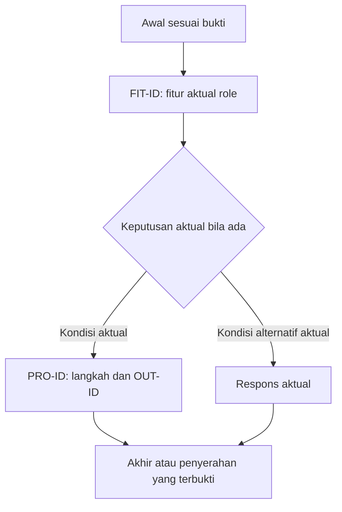

# Alur Program per Role

Status: DRAFT. Isi berdasarkan aplikasi yang diperiksa; placeholder bukan hasil verifikasi. Bab ini mengisi Bab 5–6 pada template laporan induk: inventaris role/fitur pada Bab 5, alur/flowchart/output pada Bab 6.

Bab ini membantu pimpinan memahami bagaimana masing-masing peran pengguna menjalankan pekerjaannya melalui aplikasi dan hasil apa yang diterima. Awali setiap pembahasan peran dan proses dengan paragraf yang menjelaskan tujuan pekerjaan, langkah yang dilakukan, hubungan dengan pihak lain, serta manfaat dan batasan hasilnya. Tabel berikut merupakan pendukung narasi dan harus dijelaskan maknanya. Ganti petunjuk dengan uraian lengkap berdasarkan bukti saat template digunakan.

- Aplikasi dan versi: [isi]
- Branch dan commit yang diperiksa: [isi]
- Tanggal dan penanggung jawab: [isi]
- Lingkungan pemeriksaan/pengujian: [isi]
- Referensi: [dokumen ISO 04/05, kode, hasil tes, screenshot]

## 1. Daftar role dan cakupan akses

Daftarkan hanya role yang benar-benar ditemukan. Periksa definisi role/permission, konfigurasi autentikasi, pembatasan endpoint/halaman, kebijakan akses, dan data role yang diizinkan. Catat sumber, tanggal, commit/lingkungan, serta perbedaan definisi bawaan dan kondisi aktual. Data awal saja belum membuktikan role aktif. Jangan menambahkan role tamu berdasarkan asumsi. Jika ada halaman tanpa login, catat terpisah sebagai akses publik, bukan otomatis role tamu. Jika izin individual digunakan tanpa role bernama, jelaskan model aktualnya.

Jelaskan pembatasan kepemilikan data atau unit kerja. Nama role pada kode dipertahankan dan diberi penjelasan umum; gunakan ROL-ID sebagai referensi. Tabel berikut adalah inventaris role, bukan daftar role contoh yang wajib ada.

| ID dan role aktual | Tujuan/tanggung jawab | Menu dan tindakan yang diizinkan | Batas akses data/tindakan | Bukti kode dan status verifikasi |
| --- | --- | --- | --- | --- |
| [role] | [isi] | [isi] | [isi] | [path/simbol pada commit terkait; status] |

## 2. Alur penggunaan setiap role

Ulangi bagian berikut untuk **setiap role**, lalu ulangi tabel proses untuk **setiap proses yang dapat dijalankan role tersebut**.

### Role: [nama role terverifikasi]

[Jelaskan dengan bahasa umum siapa pemegang peran ini, tanggung jawabnya, mengapa aksesnya diperlukan, dan bagaimana pekerjaannya berhubungan dengan peran lain. Jelaskan batas wewenangnya melalui perilaku aplikasi yang telah diperiksa.]

- Tujuan penggunaan: [isi]
- Prasyarat akun, hak akses, dan data: [isi]
- Cara masuk dan halaman/dashboard awal: [isi; N/A dengan alasan untuk akses publik]
- Menu yang tersedia dan fungsinya: [isi]
- Cara mengakhiri sesi: [isi jika berlaku]

#### Fitur yang diperoleh role ini

[Jelaskan pekerjaan yang dibantu setiap fitur dan batas wewenangnya. Ulangi tabel per fitur agar tetap terbaca saat dicetak. Catat seluruh fitur yang tersedia, termasuk tindakan tanpa menu bila ditemukan. Fitur bersama cukup dijelaskan sekali dan dirujuk kembali dengan perbedaan izin setiap role.]

| Informasi | Isi berdasarkan pemeriksaan |
| --- | --- |
| ID dan nama fitur | [FIT-ID dan nama aktual] |
| Tujuan dan kebutuhan terkait | [makna bagi pengguna; KEB-ID] |
| Cara akses | [menu/halaman/operasi aktual] |
| Tindakan yang diizinkan | [hanya tindakan aktual: melihat, membuat, mengubah, menghapus, menyetujui, atau lainnya] |
| Batas data dan kondisi | [cakupan data, prasyarat, kepemilikan/unit/status] |
| Penolakan | [tindakan/data yang ditolak dan respons aktual] |
| Proses dan flowchart | [PRO-ID, diagram dan node/cabang yang membahas fitur] |
| Output | [OUT-ID dan penerima] |
| Bukti kode | [BKT-ID, path/simbol, commit] |
| Pengujian akses aktual | [UJI-ID, diizinkan/ditolak, hasil, lingkungan; Belum terverifikasi jika belum diuji] |

Tampilan menu tidak cukup membuktikan izin. Cocokkan pembatasan pada kode dan hasil uji tindakan/data. Jangan menguji di produksi tanpa izin.

#### Flowchart wajib role ini

[Beri diagram ID, nama role aktual, versi/commit, sumber BKT, dan batas verifikasi. Jelaskan alur dalam paragraf sebelum diagram: awal, fitur, keputusan, hasil, dan penyerahan pekerjaan jika ada. Setiap FIT harus muncul pada diagram ringkasan atau diagram turunan yang dirujuk.]

Kerangka Mermaid di bawah adalah petunjuk pengisian, bukan alur aplikasi. Ganti seluruh node dan cabang sesuai bukti; jangan mempertahankan login, validasi, penyerahan, atau jalur gagal jika tidak ditemukan. Gunakan satu diagram utama per role dan diagram turunan untuk proses rumit. Simpan sumber Mermaid pada Markdown dan tampilkan diagram yang sudah dirender dalam PDF.

[Setelah diagram, jelaskan arti keputusan, hasil, dan keterbatasan. Hubungkan node ke PRO/FIT/OUT dan bukti. Pecah diagram bila teks terlalu kecil di PDF; label cabang harus menjelaskan kondisi, bukan panah tanpa makna.]

#### Proses: [nama proses / PRO-ID]

[Uraikan proses dari kebutuhan awal hingga selesai dalam paragraf yang mudah diikuti: siapa memulai, apa yang diisi/diperiksa, bagaimana sistem merespons, siapa melanjutkan, dan kapan pekerjaan dianggap selesai. Jelaskan pula akibat jika proses gagal atau belum dapat dilanjutkan.]

- Pemicu dan kondisi awal: [isi]
- Hasil akhir yang diharapkan: [isi]

| Langkah | Menu/halaman | Tindakan pengguna dan input | Respons sistem/validasi | Perubahan data atau status | Bukti dan status verifikasi |
| --- | --- | --- | --- | --- | --- |
| 1 | [isi] | [isi] | [isi] | [isi atau tidak berubah] | [referensi kode, ID tes, gambar; status] |

- Alur alternatif/kegagalan: [input tidak valid, data tidak tersedia, atau kondisi lain yang ditemukan beserta respons sistem]
- Batas otorisasi: [tindakan/data yang ditolak dan bukti pemeriksaan atau tesnya]
- Penyerahan ke role lain: [role tujuan, kondisi penyerahan, status/data yang diterima, dan langkah berikutnya; N/A beserta alasan jika tidak ada]
- Diagram alur: [rujuk diagram role dan node proses; tambahkan diagram turunan bila rumit, dari awal sampai hasil/penyerahan aktual]
- Screenshot: [nomor gambar, keterangan langkah, lokasi bukti asli dengan data sintetis; Belum terverifikasi bila belum tersedia]

#### Output proses

[Jelaskan dalam paragraf apa hasil proses ini, mengapa hasil tersebut dibutuhkan penerima, bagaimana hasil diperoleh dan digunakan, serta keterbatasannya. Bedakan hasil yang diharapkan dari hasil aktual yang sudah dibuktikan.]

Ulangi rincian berikut untuk **setiap output** proses ini. Sertakan hasil yang dibuat role ini maupun hasil yang diterima dari role lain, dengan merujuk proses asalnya. Catat hanya jenis output yang benar-benar ditemukan; bila proses tidak menghasilkan output, tulis N/A dengan alasan berdasarkan pemeriksaan.

- ID, nama, dan tujuan output: [isi]
- Proses asal, role pemicu, dan waktu/kondisi pembentukan: [isi]
- Bentuk dan format: [tampilan, data/status tersimpan, dokumen, ekspor, notifikasi, respons API, atau bentuk lain yang ditemukan; format file jika ada]
- Isi utama: [kolom/field, arti data, satuan, ringkasan/perhitungan, dan status yang ditampilkan jika berlaku]
- Sumber dan cakupan data: [sumber data, filter, periode, serta batas kepemilikan/unit kerja jika berlaku]
- Penerima dan hak akses: [role yang dapat melihat/menerima, mengunduh, mencetak, atau meneruskan output sesuai fitur yang tersedia]
- Cara memperoleh hasil: [menu/halaman, tindakan unduh/cetak, kanal penerimaan, atau endpoint yang terverifikasi]
- Hasil yang diharapkan: [isi berdasarkan kebutuhan/use case]
- Hasil aktual: [isi dari pemeriksaan/pengujian beserta status; Belum terverifikasi jika belum diperiksa]
- Kondisi kosong/gagal/ditolak: [hasil atau pesan sistem dan apakah output tetap terbentuk; N/A beserta alasan bila tidak berlaku]
- Contoh output: [cuplikan/screenshot atau berkas contoh dengan data sintetis, nomor gambar/lampiran, dan lokasi bukti]
- Referensi verifikasi: [path/simbol kode pada commit terkait, ID tes, dan bukti aktual; bedakan pemeriksaan kode dari pengujian]

#### Tujuan dan pengiriman email (jika output melalui email)

[Jelaskan kepada pimpinan siapa menerima email, mengapa orang tersebut dipilih, kapan email dibuat, apa isinya, dan apa yang harus dilakukan penerima. Jelaskan To sebagai penerima utama, CC sebagai penerima salinan, dan BCC sebagai penerima salinan yang alamatnya tidak ditampilkan kepada penerima lain, jika digunakan. Jangan menyamakan masuk antrean dengan telah diterima.]

Ulangi untuk setiap jenis email. Jika tidak menggunakan email, tulis N/A berdasarkan pemeriksaan. Gunakan alamat sintetis atau samarkan alamat pribadi dalam laporan, tanpa menghilangkan penjelasan sumber dan aturan pemilihannya.

| Jenis penerima | Role/pihak tujuan | Alamat tujuan (sintetis/disamarkan) | Sumber alamat | Aturan pemilihan penerima | Referensi kode/bukti |
| --- | --- | --- | --- | --- | --- |
| To | [isi] | [isi] | [field akun, konfigurasi, input, atau sumber terverifikasi lainnya] | [kondisi/relasi penentu penerima] | [isi] |
| CC | [isi atau N/A] | [isi atau N/A] | [isi atau N/A] | [isi atau N/A] | [isi] |
| BCC | [isi atau N/A] | [isi atau N/A] | [isi atau N/A] | [isi atau N/A] | [isi] |

- Subjek dan ringkasan isi/lampiran: [isi]
- Pemicu dan mekanisme pengiriman: [langsung/antrean sesuai implementasi, serta waktu/kondisi pengiriman]
- Penanganan alamat kosong/tidak valid dan kegagalan: [respons, retry, atau tindak lanjut yang terverifikasi]
- Status aktual dan bukti: [dibuat/masuk antrean, diterima layanan pengirim, atau terbukti masuk kotak penerima; tulis Belum terverifikasi untuk tahap tanpa bukti]

## 3. Hubungan alur antar-role

| Proses | Role asal dan tindakan | Status sebelum → sesudah | Role penerima dan tindak lanjut | Kondisi penolakan/perbaikan | Referensi bukti |
| --- | --- | --- | --- | --- | --- |
| [isi] | [isi] | [isi] | [isi] | [isi atau N/A beserta alasan] | [isi] |

Jika tidak ada proses antar-role, tulis N/A beserta alasan berdasarkan pemeriksaan.

## 4. Kelengkapan dan batas verifikasi

- Cocokkan seluruh role dan proses dengan dokumen ISO 04/05 serta kode aplikasi.
- Pisahkan bukti pemeriksaan kode, pengujian aktual, dan screenshot. Cantumkan hasil aktual beserta ID bukti; jangan mengklaim lulus tanpa pengujian.
- Catat role, proses, alur alternatif, atau batas akses yang belum diuji sebagai Belum terverifikasi, beserta dampak dan tindak lanjutnya.
- Pastikan diagram, tabel langkah, perubahan status, dan screenshot konsisten dengan versi yang dilaporkan.
- Pastikan setiap proses memiliki rincian seluruh output, termasuk penerima, isi, cara memperoleh hasil, dan bukti; catat output yang belum diuji sebagai Belum terverifikasi.

- Setiap role aktual memiliki flowchart sendiri dan daftar seluruh fitur; setiap FIT terhubung ke diagram utama/turunan, PRO, OUT, dan bukti.
- Pastikan tidak ada role tamu rekaan atau fitur rekaan. Akses publik dicatat terpisah hanya jika ditemukan.
- Buat matriks ringkas role–fitur–tindakan–batas data dari tabel rincian; perbedaan izin tidak boleh hilang pada ringkasan.

## 5. Pemetaan ISO dan keterlacakan

Jelaskan acuan yang dipilih untuk kebutuhan, akses, dan dokumentasi pengujian. Gunakan format [pemetaan ISO](../../standards/iso-mapping.md), termasuk edisi, klausul terverifikasi, makna, penerapan, bagian dokumen, BKT, status, kesenjangan, dan tindak lanjut. Rujuk pemetaan pada dokumen ISO 03/04/05/12 jika sama; jangan menyalin kesimpulan yang berbeda. Nomor dokumen internal 04/05 bukan nomor klausul ISO.

| Kebutuhan/pemetaan | Role dan fitur | Proses/diagram | Output/penerima | Pengujian dan bukti | Hasil, batas, dan tindak lanjut |
| --- | --- | --- | --- | --- | --- |
| [KEB-ID/ISO-ID] | [ROL-ID/FIT-ID] | [PRO-ID/diagram/node] | [OUT-ID/role aktual] | [UJI-ID/BKT-ID] | [isi] |
