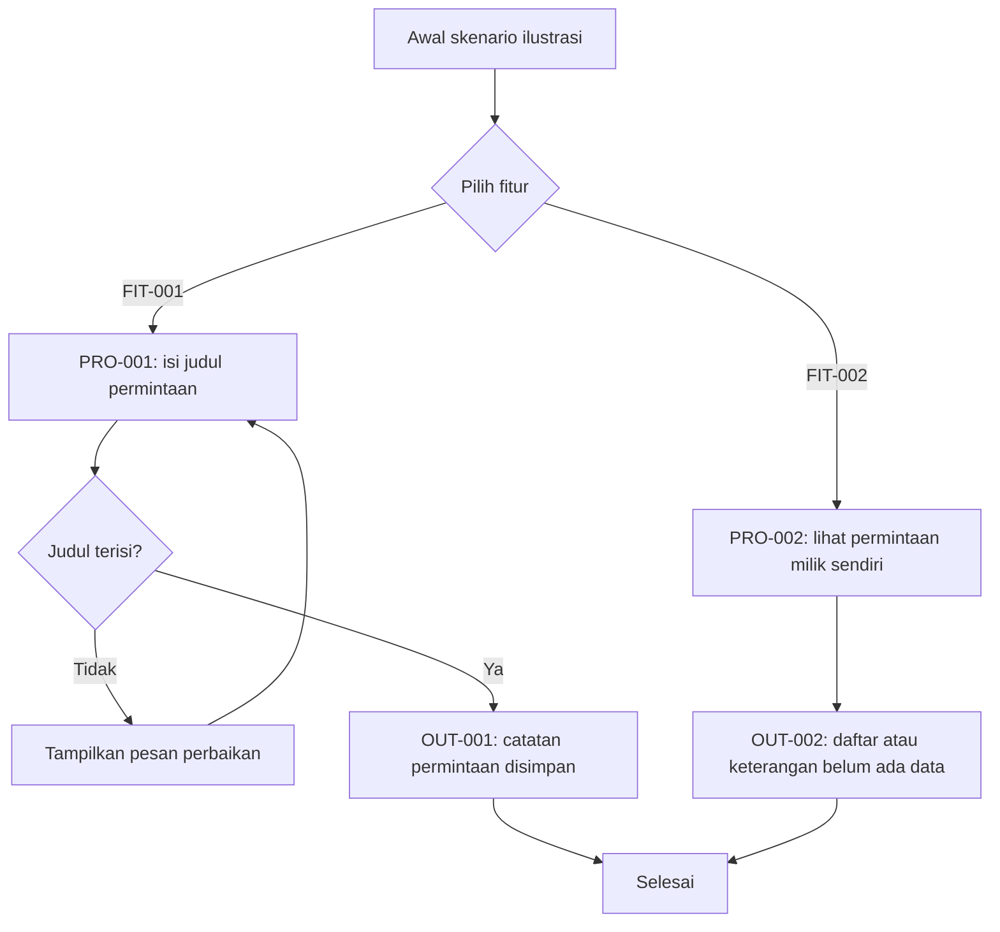

# Contoh Sintetis — Penjelasan Role, Fitur, dan Alur

> ILUSTRASI / DRAFT. Seluruh nama, role, fitur, data, ID, dan hasil di sini dibuat untuk menjelaskan pola penulisan. Ini bukan dokumentasi aplikasi nyata, bukan bukti pengujian, dan tidak boleh dipakai sebagai daftar role bawaan.

Contoh ini menunjukkan cara menjelaskan pekerjaan kepada pembaca umum sambil menyediakan hubungan ke rincian yang perlu diperiksa tim IT. Aplikasi ilustrasi membantu pencatatan permintaan layanan. Hanya satu peran ilustratif digunakan, yaitu **Peran Contoh A**. Aplikasi nyata harus menggunakan role yang ditemukan melalui pemeriksaan, tanpa menyalin nama ini atau menambah role tamu.

## Identitas dan konteks ilustrasi

Dokumen ilustrasi versi 0.1 ini dibuat pada 31 Oktober 2026 untuk latihan pengisian. Tidak ada commit, lingkungan aplikasi, pemeriksa aplikasi, atau pengesahan nyata. Peran, hak akses dan alur di bawah adalah asumsi skenario latihan, sehingga seluruh penerapan aktual tetap **Belum terverifikasi**.

## Tujuan, fitur, dan batas peran

Dalam skenario ilustrasi, Peran Contoh A mencatat kebutuhan layanan agar uraian pekerjaan dapat disimpan dan dibaca kembali. Pengguna hanya dapat mengelola permintaan miliknya. Kebutuhan latihan KEB-001 adalah mencatat permintaan dengan judul yang tidak kosong. Tujuan ini membantu memperlihatkan hubungan kebutuhan, fitur, alur, dan hasil; tidak menyatakan aplikasi nyata sudah melakukannya.

**Tabel 1. Rincian fitur ilustratif.** Tabel menjelaskan kemampuan yang diasumsikan dalam latihan, bukan izin yang telah diperiksa pada suatu aplikasi.

| Informasi | Isi ilustrasi |
| --- | --- |
| Role | ROL-001 — Peran Contoh A; tidak berasal dari aplikasi nyata |
| Fitur | FIT-001 — Mencatat permintaan; FIT-002 — Melihat permintaan milik sendiri |
| Tindakan/batas | Mengisi dan menyimpan permintaan, lalu melihat data milik sendiri; perubahan/penghapusan tidak dicakup contoh |
| Prasyarat | Akses diberikan dalam skenario; mekanisme login tidak diasumsikan |
| Proses/output | PRO-001 menghasilkan OUT-001; PRO-002 menampilkan OUT-002 |
| Bukti aktual | Tidak tersedia; izin, penyimpanan, dan pembatasan data Belum terverifikasi |

## Flowchart Peran Contoh A

**Gambar 1. Diagram ilustrasi DIA-001.** Pengguna memilih pencatatan atau melihat data. Pada pencatatan, judul yang kosong menyebabkan pengguna diminta memperbaiki isian; judul yang terisi menghasilkan catatan. Diagram hanya menunjukkan aturan latihan dan tidak mengasumsikan ada persetujuan atau penyerahan ke role lain.

Diagram mencakup kedua fitur contoh. Alur kegagalan penyimpanan dan penolakan akses di luar kepemilikan belum dirinci pada latihan ini; pada aplikasi nyata, respons yang ditemukan harus dijelaskan dan diverifikasi. Diagram bukan hasil pengujian.

## Langkah dan output

Untuk PRO-001, pengguna mengisi judul, sistem memeriksa kewajiban pengisian, lalu menyimpan catatan jika memenuhi aturan latihan. Kriteria penerimaan ilustratifnya adalah judul kosong tidak menghasilkan catatan baru, sedangkan judul terisi menghasilkan catatan yang dapat dilihat pemilik. Tidak ada hasil aktual yang telah dijalankan.

**Tabel 2. Output skenario.** Kedua output berasal dari data latihan dan tidak membuktikan format atau perilaku aplikasi mana pun.

| Output | Isi, sumber, dan cara memperoleh | Penerima/batas | Kondisi dan status aktual |
| --- | --- | --- | --- |
| OUT-001 | Catatan judul “Perbaikan ruang latihan”; input PRO-001; tersimpan setelah validasi dalam skenario | Peran Contoh A, data milik sendiri | Penyimpanan aktual Belum terverifikasi |
| OUT-002 | Daftar catatan milik sendiri; dibuka melalui FIT-002; tanpa periode/filter tambahan dalam skenario | Peran Contoh A, tidak mencakup data pihak lain | Jika kosong tampil keterangan; seluruh perilaku aktual Belum terverifikasi |

Skenario latihan tidak menggunakan email, ekspor, atau integrasi; jenis tersebut tidak ditambahkan sebagai fitur contoh. Pada aplikasi nyata, ketidakberlakuan harus diperiksa dan diberi alasan, bukan disimpulkan dari contoh ini.

## Rencana pengujian dan keterlacakan

Pengujian ilustratif yang diperlukan adalah UJI-001 untuk judul kosong, UJI-002 untuk penyimpanan judul terisi, UJI-003 untuk tampilan daftar kosong, dan UJI-004 untuk pembatasan data pemilik. Semua berstatus **Belum dijalankan**. Tidak ada screenshot, log, atau BKT aktual yang tersedia. Tautan bukti tidak dibuat agar pembaca tidak menganggapnya hasil pemeriksaan.

**Tabel 3. Hubungan informasi ilustrasi.** Referensi memperlihatkan apa yang perlu ditelusuri saat aplikasi sungguhan diperiksa.

| Kebutuhan | Role/fitur | Proses/diagram | Output | Pengujian | Bukti/kesimpulan |
| --- | --- | --- | --- | --- | --- |
| KEB-001 | ROL-001/FIT-001 | PRO-001/DIA-001 | OUT-001 | UJI-001/002 | Belum tersedia/Belum terverifikasi |
| KEB-001 | ROL-001/FIT-002 | PRO-002/DIA-001 | OUT-002 | UJI-003/004 | Belum tersedia/Belum terverifikasi |

## Contoh pemetaan ISO yang belum dapat disimpulkan

Acuan ilustratifnya ISO/IEC/IEEE 29148:2018 karena pembahasan memuat kebutuhan dan kriteria penerimaan. Lingkup umum standar dapat ditelusuri pada [katalog ISO](https://www.iso.org/standard/72089.html); katalog tidak menggantikan pemeriksaan naskah klausul. Karena itu, contoh ini sengaja tidak menyebut nomor klausul atau menyatakan kesesuaian.

| Informasi | Isi ilustrasi |
| --- | --- |
| ID pemetaan | ISO-001 |
| Standar/edisi | ISO/IEC/IEEE 29148:2018; amendemen yang berlaku belum diperiksa |
| Klausul/kontrol dan judul | Belum terverifikasi — naskah klausul belum diperiksa |
| Makna/relevansi | Menjelaskan kebutuhan dan cara menilai hasil yang diharapkan |
| Sumber persyaratan | Katalog resmi untuk lingkup umum; naskah klausul belum tersedia dalam contoh |
| Penerapan/bagian | KEB-001 dan bagian langkah/output dalam ilustrasi, bukan aplikasi nyata |
| Bukti/batas | Tidak ada BKT aplikasi atau pengujian; contoh format saja |
| Hasil penilaian | Belum terverifikasi |
| Kesenjangan/dampak | Tidak dapat menyimpulkan persyaratan tertentu telah dipenuhi |
| Tindak lanjut | Periksa naskah sah, tetapkan klausul relevan, dan kumpulkan bukti aplikasi; pemilik/target belum ditetapkan |

## Risiko dan batas penggunaan

Risiko utama adalah menyalin contoh sebagai fakta aplikasi. Saat menggunakan template, inventaris ulang role/fitur, ganti seluruh isi ilustrasi, periksa klausul relevan, kumpulkan bukti, dan catat hasil yang benar-benar ditemukan. Dokumen ini hanya menguji pola penyajian, bukan kelengkapan laporan induk atau kepatuhan aplikasi.

## Glosarium

Role berarti peran pengguna. Fitur berarti kemampuan aplikasi untuk suatu pekerjaan. Flowchart adalah diagram urutan dan keputusan proses. Output adalah hasil proses. Commit adalah identitas catatan perubahan kode. Kriteria penerimaan adalah kondisi yang digunakan untuk menilai apakah kebutuhan telah dipenuhi.

## Riwayat revisi

31 Oktober 2026 — versi 0.1: contoh sintetis pola narasi, role/fitur, flowchart, output, dan pemetaan yang belum terverifikasi; tanpa pemeriksaan aplikasi atau pengesahan.
